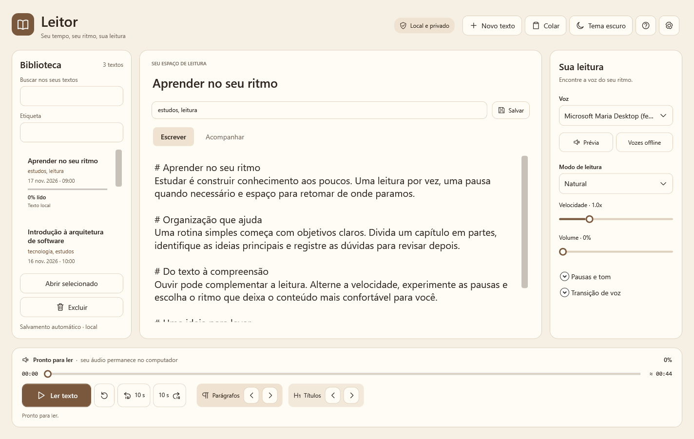
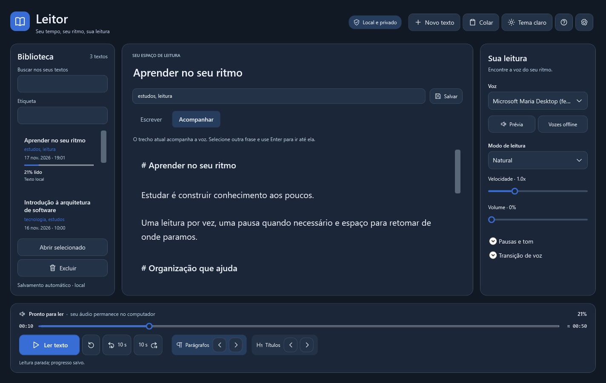
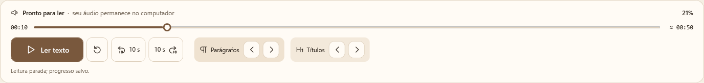
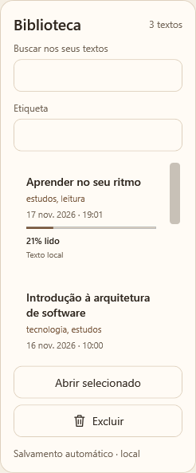
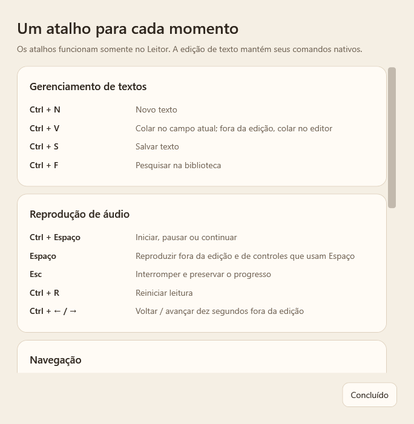
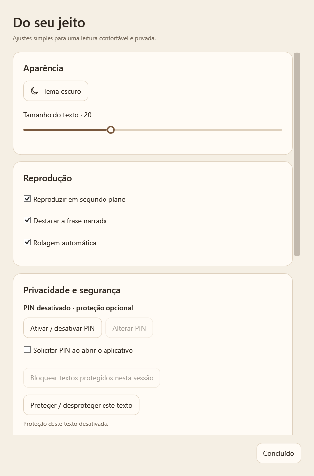
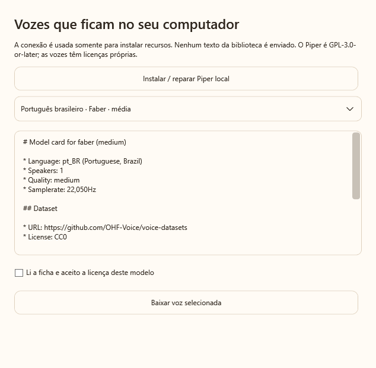
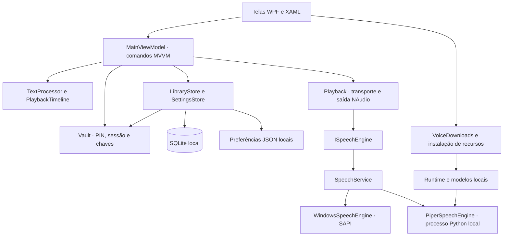

<div align="center">


# Leitor de Texto

**Seu tempo, seu ritmo, sua leitura**

Leitura em áudio para estudar no seu ritmo, com vozes neurais locais e uma biblioteca no seu computador.

[](src/Leitor/Leitor.csproj)
[](src/Leitor/Leitor.csproj)
[](src/Leitor/MainWindow.xaml)
[](src/Leitor/ViewModels/MainViewModel.cs)
[](src/Leitor/Services/Storage.cs)

[](src/Leitor/Services/SpeechEngines.cs)
[](#instalação-e-primeiros-passos)
[](CHANGELOG.md)
[](LICENSE)
[](#vozes-neurais-e-uso-offline)

[Sobre](#sobre-o-projeto) · [Demonstração](#demonstração) · [Instalação](#instalação-e-primeiros-passos) · [Arquitetura](#tecnologias-e-arquitetura) · [Validação](#desempenho-e-validação) · [Documentação](#documentação)

</div>

## Sobre o projeto

O **Leitor de Texto** é um aplicativo desktop gratuito que transforma textos em áudio usando síntese de voz do Windows e inteligência artificial local para vozes neurais com Piper TTS.

O projeto surgiu da necessidade de facilitar a leitura de materiais extensos, especialmente conteúdos acadêmicos, e permitir estudar enquanto se realizam outras atividades. A proposta é complementar a leitura com uma experiência de escuta confortável, mantendo os textos, a biblioteca e o processamento no próprio computador.

Três princípios orientam as decisões de implementação:

| Princípio | Aplicação no projeto |
| --- | --- |
| **Simplicidade** | Editor direto, biblioteca local, controles visíveis e atalhos contextuais. |
| **Desempenho** | Reprodução progressiva, cancelamento e preparação do destino sem sintetizar o documento inteiro. |
| **Naturalidade da voz** | Pontuação preservada, vozes neurais opcionais e pausas ajustáveis para diferentes ritmos de estudo. |

O desenvolvimento reúne práticas demonstráveis de C#/WPF, MVVM, programação assíncrona, persistência, integração com processos locais, proteção de dados e testes de regressão. A versão atual é **1.2.1**; funcionalidades futuras estão separadas no [roadmap](#possibilidades-futuras).

## Demonstração

Capturas do conteúdo das **telas WPF reais da versão 1.2.1**, renderizadas em ambiente isolado, com textos e progresso fictícios. Não há documentos pessoais nas imagens. O player foi capturado parado, sem reproduzir áudio. [Procedência das capturas](docs/images/README.md).

### Tema claro · editor e biblioteca



### Tema escuro · acompanhamento da leitura



### Reprodução e navegação



<details>
<summary><strong>Ver biblioteca, atalhos, configurações e vozes neurais</strong></summary>

**Biblioteca de textos** — títulos, etiquetas, data e progresso em uma coleção local.



**Central de atalhos** — ajuda por F1, organizada por contexto.



**Configurações** — aparência, reprodução e privacidade em uma janela própria.



**Vozes neurais** — instalação local e ficha de licença antes do download de um modelo.



</details>

## Funcionalidades

| Categoria | Recursos implementados |
| --- | --- |
| **Textos extensos** | Segmentação progressiva em frases e blocos, preservação do original, cancelamento e navegação sem um limite artificial de palavras definido pela aplicação. |
| **IA e vozes neurais** | Piper local opcional, catálogo com Faber/Edresson em português brasileiro e LJ Speech em inglês; alternativa com vozes Windows/SAPI. |
| **Personalização** | Modos Natural, Rápida, Estudos e Personalizada; velocidade, volume, pausas e transição de voz. Tom disponível no motor Windows, conforme suporte da voz. |
| **Reprodução** | Iniciar, pausar, continuar, reiniciar, prévia de voz, ±10 segundos, clique/arraste com prévia de tempo e navegação por parágrafos/títulos. |
| **Acompanhamento** | Frase atual separada da seleção manual, destaque opcional e rolagem automática configurável. |
| **Biblioteca** | Títulos, etiquetas, busca por título/conteúdo, filtro por etiqueta, exclusão com confirmação e indicadores de progresso/conclusão. |
| **Salvamento e retomada** | Autosave, salvamento manual e progresso independente por documento, com posição fracionária e durações conhecidas. |
| **Privacidade** | Síntese local, PIN opcional, criptografia individual de documentos e bloqueio da sessão protegida. |
| **Interface e produtividade** | Temas claro bege/escuro, fonte ajustável, foco visível, nomes acessíveis e central F1 com atalhos contextuais. |
| **Uso offline** | Leitura sem conexão após preparar os recursos locais necessários; nenhuma conta ou serviço pago é exigido. |

Na 1.2.1, a barra preserva reprodução, pausa ou parada e prioriza a solicitação mais recente. O símbolo **≈** identifica estimativas; o total e o percentual podem mudar conforme novos trechos são medidos. A sincronização é por frase/bloco, sem promessa de alinhamento por palavra ou amostra acústica. [Detalhes de reprodução](docs/REPRODUCAO-1.2.1.md).

## Instalação e primeiros passos

**Requisitos:** Windows 10/11 de 64 bits. A distribuição autossuficiente inclui o runtime .NET; executar pelo código-fonte requer o SDK .NET 10 ou a preparação feita pelo script do projeto.

**Distribuição pública:** na consulta de 17/11/2026, o repositório não tinha releases publicadas. Não há link de instalador público disponível neste README. A página de [Releases](https://github.com/0-GBL/Leitor_de_Texto/releases) permite consultar esse estado. A pasta `artifacts/` é gerada localmente e está ignorada pelo Git.

| Forma de uso | Procedimento |
| --- | --- |
| **Instalador Windows** | Com o pacote local disponível, execute `artifacts/Leitor-Instalador.exe`. A instalação é por usuário. |
| **Portátil** | Extraia `artifacts/Leitor-portatil.zip` e execute `Leitor.exe` dentro da pasta extraída. |
| **Código-fonte** | Clone o repositório e use os comandos abaixo em PowerShell no Windows. |

```powershell
git clone https://github.com/0-GBL/Leitor_de_Texto.git
cd Leitor_de_Texto
powershell -NoProfile -ExecutionPolicy Bypass -File .\scripts\Build.ps1
.\.tools\dotnet\dotnet.exe run --project .\src\Leitor\Leitor.csproj -c Release
```

O script prepara o SDK em `.tools/` quando necessário, compila e executa testes. A preparação inicial requer internet. Testes de áudio exigem uma saída de áudio disponível; os testes neurais dependem do runtime/modelos locais. Para gerar os pacotes:

```powershell
powershell -NoProfile -ExecutionPolicy Bypass -File .\scripts\Build.ps1 -Package
```

O instalador atual **não tem assinatura Authenticode**; o Windows pode mostrar avisos de editor desconhecido. Feche o Leitor antes de atualizar ou desinstalar. Instalação e versão portátil usam os dados em `%LOCALAPPDATA%\Leitor`; a biblioteca não fica junto ao executável. A desinstalação preserva textos e vozes.

### Criar e ouvir um texto

1. Clique em **Novo texto** ou cole o conteúdo no editor.
2. Informe título e, se desejar, etiquetas separadas por vírgula.
3. Escolha uma voz e um modo de leitura. Use **Prévia** para experimentar a voz.
4. Clique em **Ler texto** e abra **Acompanhar** para seguir as frases.
5. Pause quando precisar e retome pelo mesmo documento da biblioteca. O salvamento é automático; **Ctrl+S** salva imediatamente.

### Vozes neurais e uso offline

1. Abra **Vozes offline** e escolha **Instalar / reparar Piper local**.
2. Selecione o modelo, leia sua ficha e aceite a licença antes do download.
3. Volte à interface principal e selecione a voz instalada.
4. Depois da preparação, a narração usa apenas recursos locais. As vozes Windows disponíveis permitem começar sem instalar Piper.

Python/Piper são instalados em uma pasta própria do aplicativo. A internet é usada para obter runtime, pacotes, modelos e fichas; o texto do editor não é enviado nesses downloads. Hashes SHA-256 são verificados. As vozes possuem licenças próprias, e a disponibilidade de vozes SAPI depende do Windows. [Guia completo](docs/GUIA-DO-USUARIO.md).

## Tecnologias e arquitetura

| Tecnologia | Responsabilidade |
| --- | --- |
| **C# / .NET 10** | Lógica da aplicação, tarefas assíncronas, cancelamento e integração com o sistema. |
| **WPF / XAML** | Interface desktop, bindings, estilos, temas e controles acessíveis. |
| **MVVM** | Estado e comandos concentrados em `MainViewModel`, separados das telas e dos serviços. |
| **SQLite / Microsoft.Data.Sqlite** | Biblioteca local, consultas parametrizadas e transações de persistência. |
| **NAudio** | Saída de áudio, controle de reprodução e leitura do cursor do dispositivo. |
| **Piper TTS / Python / ONNX Runtime** | Síntese neural em processo local persistente, com comunicação por pipes. |
| **System.Speech / SAPI** | Síntese com vozes instaladas no Windows e alternativa ao motor neural. |
| **AES-GCM / PBKDF2 / DPAPI** | Proteção dos documentos e do material de chave associado ao PIN/perfil Windows. |
| **Runner de testes C# / WPF e benchmarks** | Asserções de comportamento, regressão, persistência, segurança e medições reproduzíveis. |



Texto e síntese seguem o caminho local. A rede fica restrita à obtenção dos recursos de voz. `ISpeechEngine` separa síntese de reprodução; tarefas assíncronas e tokens de cancelamento permitem substituir solicitações antigas sem bloquear a interface. Essa modularidade facilita evoluções e adaptações futuras, sem implicar uma versão web já implementada.

A estrutura está em [src/Leitor](src/Leitor), com `Core`, `Services`, `ViewModels`, `Presentation` e `Themes`; [runtime](runtime) contém o worker Python e manifestos; [shared](shared) reúne a extração segura reutilizada pelo instalador. [Detalhes técnicos](docs/REPRODUCAO-1.2.1.md).

## Atalhos de teclado

Os comandos atuam somente dentro do Leitor. A tabela foi conferida com [Shortcuts.cs](src/Leitor/Presentation/Shortcuts.cs), os handlers de janela/barra e a central **F1**.

| Atalho | Ação e contexto |
| --- | --- |
| **Ctrl+N** | Novo texto. |
| **Ctrl+V** | Colar no campo atual; fora de campos editáveis, colar no editor. |
| **Ctrl+S** | Salvar texto. |
| **Ctrl+Espaço** | Iniciar, pausar ou continuar. |
| **Espaço** | Reproduzir fora de campos editáveis e de controles que usam a tecla nativamente. |
| **Esc** | Interromper preservando progresso; fechar ajuda/configurações. Durante arraste, cancelar o destino. |
| **Ctrl+R** | Reiniciar desde o começo. |
| **Ctrl+← / →** | Retroceder/avançar dez segundos, fora da edição. |
| **Ctrl+↑ / ↓** | Parágrafo anterior/próximo, fora da edição. |
| **Ctrl+Shift+↑ / ↓** | Título anterior/próximo, fora da edição. |
| **Ctrl+T** | Alternar tema sem interromper a leitura. |
| **Ctrl+F** | Focar a busca da biblioteca. |
| **Ctrl+vírgula** | Abrir configurações. |
| **Enter na lista de frases** | Ir até a frase selecionada. |
| **F1** | Abrir a central de atalhos. |
| **Tab / Shift+Tab** | Próximo/anterior controle. |
| **Ctrl+Tab** | Sair do editor que aceita tabulação. |
| **← / → com foco na barra** | Prévia de −5/+5 segundos; soltar confirma. |
| **Page Up / Page Down na barra** | Avançar/retroceder trinta segundos. |
| **Home / End na barra** | Selecionar início/final da leitura; soltar confirma. |

Movimentação do cursor, seleção e espaços mantêm o comportamento nativo nos campos. Não há atalhos globais no sistema nem atalho de exclusão. A tecla de vírgula é tratada como `OemComma`; a validação com teclado ABNT2 físico permanece pendente.

## Privacidade e segurança

Os textos e a síntese ficam no computador. A biblioteca usa SQLite e o **PIN é opcional, desligado por padrão** em instalações novas. O bloqueio ao abrir restringe a interface; **não criptografa automaticamente todos os documentos**. A proteção precisa ser ativada individualmente para cada texto.

- **AES-256-GCM:** cifra título, conteúdo, etiquetas e progresso dos documentos protegidos, com integridade autenticada e vínculo à identidade do documento.
- **PBKDF2-SHA256:** deriva a chave de proteção a partir do PIN com 600.000 iterações; o PIN não é salvo em texto simples.
- **DPAPI:** vincula a proteção adicional da chave ao perfil Windows atual.
- **Tentativas e sessão:** espera progressiva de 2 a 30 segundos, persistida entre sessões; troca de PIN sem substituir a chave dos documentos e bloqueio explícito da sessão protegida.
- **Persistência e recursos externos:** consultas parametrizadas, transações, gravação atômica de configurações/cofre, ACL em novas pastas, extração segura e verificação SHA-256 de downloads.

Não há recuperação do PIN. Copiar o cofre para outra conta/computador não basta para abrir os textos. A proteção não impede malware na mesma conta, administrador ou inspeção de memória desbloqueada. A limitação de tentativas pode ser contornada por quem controla os arquivos da conta; `secure_delete` não elimina backups/snapshots ou garante apagamento físico em SSD. Nenhuma certificação ou segurança absoluta é prometida.

O formato protegido da 1.2.x lê documentos antigos; gravar com ele impede reabertura na 1.1 sem restaurar um backup compatível. [Revisão de segurança e limites](docs/SEGURANCA-1.2.md) · [Dados, PIN e procedimentos](docs/GUIA-DO-USUARIO.md#privacidade-e-segurança).

## Desempenho e validação

Os números abaixo vêm dos relatórios existentes, não de novas execuções da suíte nesta tarefa de documentação.

| Versão | Registro de validação |
| --- | --- |
| **1.0.0** | 11 testes aprovados no histórico informado pelo autor; relatório dessa execução não está versionado neste repositório. |
| **1.1.0** | [19 testes aprovados](docs/VALIDACAO-1.1.0.md), incluindo downloads reais. |
| **1.2.0** | [25 testes aprovados](docs/VALIDACAO-1.2.0.md). |
| **1.2.1** | [35 cenários distintos aprovados](docs/VALIDACAO.md): 34 testes locais e um download real reexecutado após timeout transitório. |

As contagens agrupam cenários com várias assertivas e não representam percentual de cobertura. Os testes incluem áudio Windows/Piper, textos extensos, SQLite, compatibilidade, PIN/criptografia, temas, atalhos e comportamento WPF. A versão 1.2.1 acrescentou clique/arraste por coordenadas na lógica do controle, prévia congelada, navegação pausada, pedidos rápidos e recuperação de falhas.

**Ensaio sintético de transporte, em 50.000 palavras:**

| Medida | 1.2.0 | 1.2.1 |
| --- | ---: | ---: |
| Vinte destinos solicitados rapidamente | 977,15 ms | 132,66 ms |
| Chamadas de síntese nessa sequência | 21 | 1 |
| Segmentação, mediana | 2,11 ms | 4,80 ms |
| Alocação da segmentação | 3,84 MB | 3,84 MB |

O ganho está no transporte e na redução de trabalho descartado; a segmentação acrescentou verificações e ficou mais lenta nessa amostra. Não é um comparativo de velocidade intrínseca das vozes. O motor do ensaio produz WAV sintético de 2 s com atraso artificial de 40 ms. A versão anterior retirava a pausa; a atual preserva o estado e prepara o último destino.

Também foram exercitados materiais de **1.000, 5.000, 10.000, 25.000 e 50.000 palavras**, além de **3,24 milhões de caracteres/120 mil frases**. São cenários, não limites máximos. Um ensaio de 30,03 s reuniu 6.400 solicitações em 320 lotes, sem crescimento acumulado de memória observado nesse intervalo curto; isso não comprova estabilidade por horas.

**Distinção dos ensaios:** testes automatizados verificam comportamento; benchmarks usam cargas sintéticas controladas; inspeções práticas observam a interface. Mouse físico, troca/desconexão real de áudio, suspensão física, Windows limpo, múltiplos DPI/monitores, ABNT2 físico, avaliação completa com Narrador/NVDA e sessões prolongadas permanecem pendentes. As capturas desta página documentam a aparência e não substituem esses testes.

[Relatório de validação](docs/VALIDACAO.md) · [Método, resultados e limitações de desempenho](docs/DESEMPENHO-1.2.1.md) · [Benchmarks e dados brutos](tests/Leitor.Bench)

## Possibilidades futuras

Ideias para avaliação, **sem compromisso de prazo ou implementação**. Nenhuma das funcionalidades abaixo faz parte da versão 1.2.1.

| Frente | Possibilidades |
| --- | --- |
| **Experiência de leitura** | Modo de concentração, marcadores, temporizador e contador de palavras/caracteres. |
| **Biblioteca e formatos** | Backup da biblioteca, importação de PDF e documentos Word. |
| **Áudio** | Exportação MP3/WAV e novos motores de voz neural. |
| **Plataformas** | Versão web e aplicativo mobile. |

### Possível sexto pilar · IA aplicada aos estudos

Uma expansão a avaliar: resumos inteligentes em texto/áudio, revisão de conteúdos acadêmicos, preparação para provas, simulados de múltipla escolha, correção com explicações, revisão interativa por voz e processamento de IA local. Essas possibilidades são distintas da síntese neural de voz já existente e **não estão implementadas**.

## Histórico de versões

| Versão | Evolução |
| --- | --- |
| **1.0.0** | Primeira versão funcional: leitura local, biblioteca e proteção opcional. |
| **1.1.0** | Correções no Piper, pontuação, interface e precisão do progresso. |
| **1.2.0** | Modernização visual, produtividade, atalhos e fortalecimento da segurança. |
| **1.2.1** | Estabilidade, barra interativa, otimização e precisão da reprodução. |

O [CHANGELOG.md](CHANGELOG.md) mantém os detalhes de cada atualização.

## Documentação

- [Guia do usuário e desenvolvimento](docs/GUIA-DO-USUARIO.md) — instalação, modos, preferências, PIN e ambiente de testes.
- [Reprodução e sincronização](docs/REPRODUCAO-1.2.1.md) — causa raiz da barra e decisões técnicas.
- [Validação da 1.2.1](docs/VALIDACAO.md) e [desempenho](docs/DESEMPENHO-1.2.1.md) — evidências e pendências.
- [Segurança](docs/SEGURANCA-1.2.md) e [dependências/licenças](THIRD-PARTY-NOTICES.md) — mecanismos, procedência e limites.
- [Imagens e método de captura](docs/images/README.md) — telas reais com dados de demonstração.

## Desenvolvedor

**Gabriel Araujo**

Desenvolvedor Full Stack em formação.

[](https://github.com/0-GBL)
[](https://www.linkedin.com/in/gabriel-araujo-5929a72ba/)
[](mailto:araujo.gabriel3289@gmail.com)

## Licença

Código disponibilizado sob **GPL-3.0-or-later**, conforme a declaração do projeto e o texto em [LICENSE](LICENSE).

Dependências e modelos mantêm licenças próprias. O Piper é opcional; os modelos não acompanham o instalador, e suas fichas devem ser consultadas antes de baixar ou redistribuir. Não se presume uma licença comercial universal para todas as vozes. Fontes, atribuições e avisos estão em [THIRD-PARTY-NOTICES.md](THIRD-PARTY-NOTICES.md).