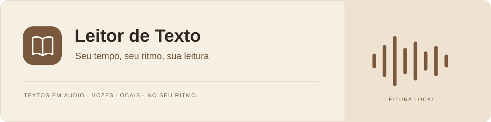
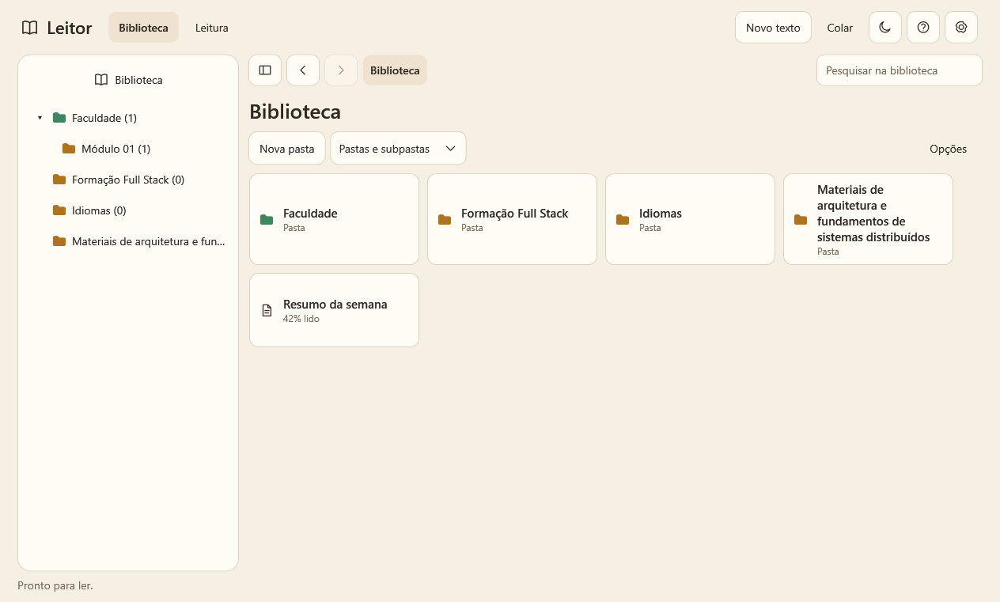
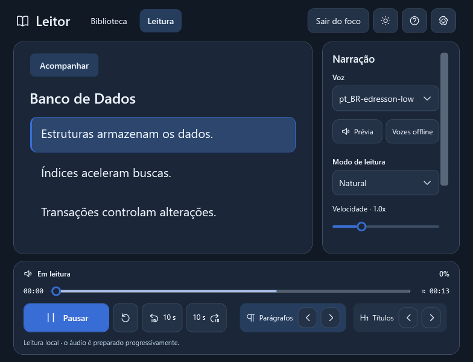

<h1 align="center"></h1>

<strong>Seu tempo, seu ritmo, sua leitura.</strong>

  
  

O **Leitor de Texto** é um aplicativo gratuito para Windows que transforma textos em áudio. Você pode organizar materiais por disciplina, ouvir um conteúdo, acompanhar a frase narrada e retomar a leitura de onde parou. A biblioteca e a síntese ficam no computador, com vozes do Windows ou vozes neurais opcionais do Piper TTS.

## Por que desenvolvi este projeto?

Quando precisava estudar textos extensos da faculdade, queria ter a opção de escutar o conteúdo e voltar ao texto sempre que precisasse conferir um trecho. Também queria reunir os materiais de diferentes disciplinas em um só lugar e continuar cada leitura sem procurar onde havia parado.

Desenvolver o Leitor me permitiu transformar essa necessidade em um aplicativo e colocar em prática o que venho estudando sobre arquitetura de software, persistência, interfaces desktop e integração com motores de voz.

## O que você pode fazer

- **Ouvir textos com vozes locais.** Use uma voz instalada no Windows ou prepare uma voz Piper para leitura offline.
- **Organizar materiais por disciplina ou tema.** Crie pastas e subpastas, navegue pelo caminho clicável e encontre documentos por busca ou filtros. Alterne entre grade e lista.
- **Acompanhar a leitura no modo foco.** Veja a frase narrada em destaque e use a rolagem automática para seguir o texto.
- **Ajustar o ritmo.** Controle velocidade, volume e pausas. Use o player para voltar a um trecho ou navegar por parágrafos e títulos.
- **Continuar de onde parou.** O aplicativo salva automaticamente o texto e mantém o progresso de cada documento.
- **Personalizar a interface.** Escolha entre os temas claro bege e escuro, ajuste a fonte e personalize os ícones de pasta.
- **Proteger documentos selecionados.** Ative a criptografia individual com um PIN opcional.

## Demonstração

### Biblioteca no tema claro

### Modo foco no tema escuro

As imagens foram capturadas no aplicativo WPF com documentos fictícios em um perfil de teste. [Procedência das capturas](docs/images/README.md)

## Download e instalação

O Leitor é destinado ao **Windows 10 ou 11 de 64 bits**. Consulte a disponibilidade dos pacotes na página de [Releases do GitHub](https://github.com/0-GBL/Leitor_de_Texto/releases).

- **Instalador** — execute `Leitor-Instalador.exe` quando tiver o pacote. A instalação é por usuário.
- **Portátil** — extraia `Leitor-portatil.zip` e abra `Leitor.exe` sem passar pelo instalador.

O instalador ainda não possui assinatura digital Authenticode. As instruções para compilar e gerar os pacotes localmente estão no [guia de desenvolvimento](docs/GUIA-DO-USUARIO.md#desenvolvimento-e-validação).

## Decisões de engenharia

- **Síntese e reprodução separadas.** A interface `ISpeechEngine` permite que o player use Piper ou Windows mantendo a mesma lógica de reprodução. O áudio é preparado por trechos, o que permite começar a ouvir enquanto o restante do texto ainda está sendo processado.
- **Biblioteca paginada em SQLite.** A listagem trabalha com resumos dos documentos. O conteúdo integral é carregado ao abrir um texto, reduzindo o volume de dados necessário para navegar pela biblioteca.
- **Interface e serviços separados por MVVM.** Os ViewModels coordenam estado e comandos. A persistência, a síntese e a reprodução ficam em serviços próprios. Os testes de regressão exercitam a navegação, a retomada e os motores de voz em perfis isolados.

**Tecnologias:** C# e .NET 10, WPF e XAML, MVVM, SQLite, NAudio, System.Speech (SAPI) e Piper TTS com Python e ONNX Runtime.

## Documentação

- [Guia do usuário](docs/GUIA-DO-USUARIO.md) e [arquitetura](docs/GUIA-DO-USUARIO.md#arquitetura)
- [Segurança e privacidade](docs/SEGURANCA-1.2.md)
- [Validação da versão 2.0.0](docs/releases/2.0.0/RELATORIO-VALIDACAO.md) e [relatórios históricos](docs/releases/)
- [Histórico de versões](CHANGELOG.md)

## Desenvolvedor

**Gabriel Araujo**

Desenvolvedor Full Stack em formação.

[GitHub](https://github.com/0-GBL) · [LinkedIn](https://www.linkedin.com/in/gabriel-araujo-5929a72ba/) · [araujo.gabriel3289@gmail.com](mailto:araujo.gabriel3289@gmail.com)

## Licença

O código é disponibilizado sob a licença [GPL-3.0-or-later](LICENSE). As dependências e os modelos de voz têm [licenças próprias](THIRD-PARTY-NOTICES.md).
